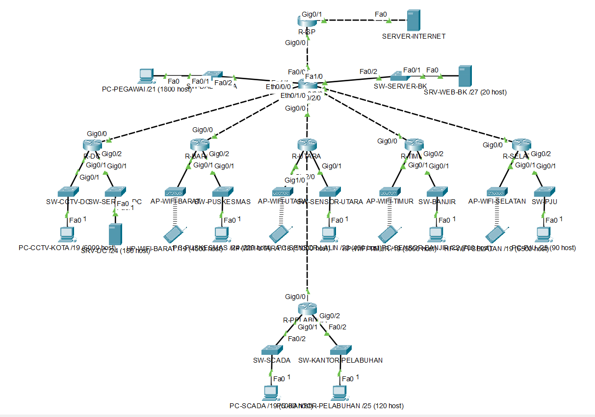
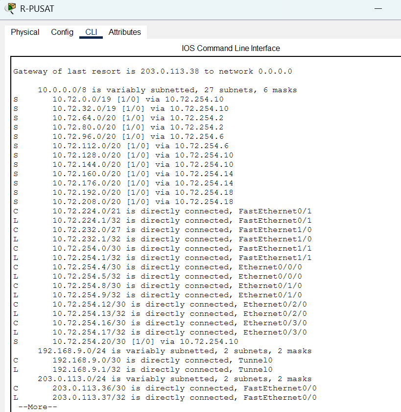
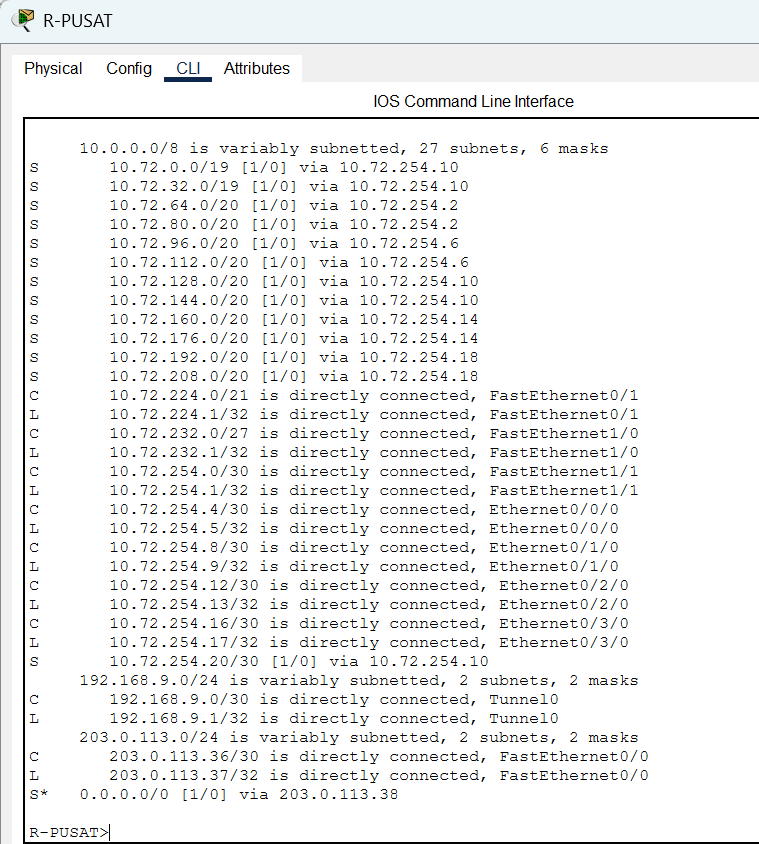
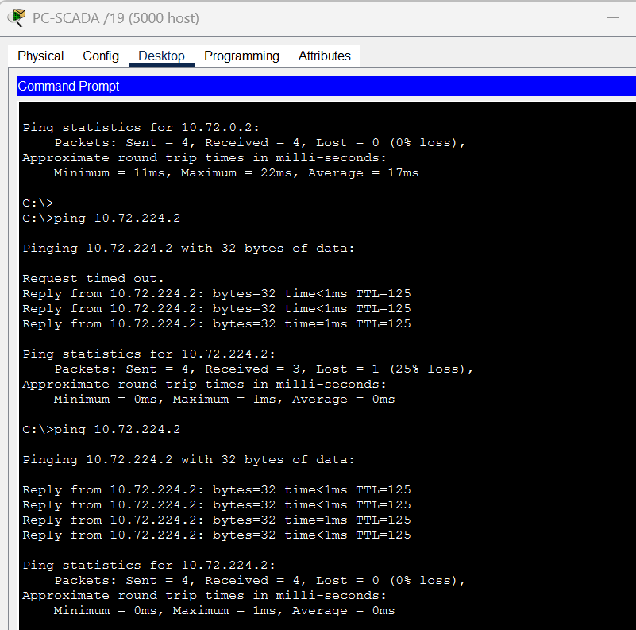
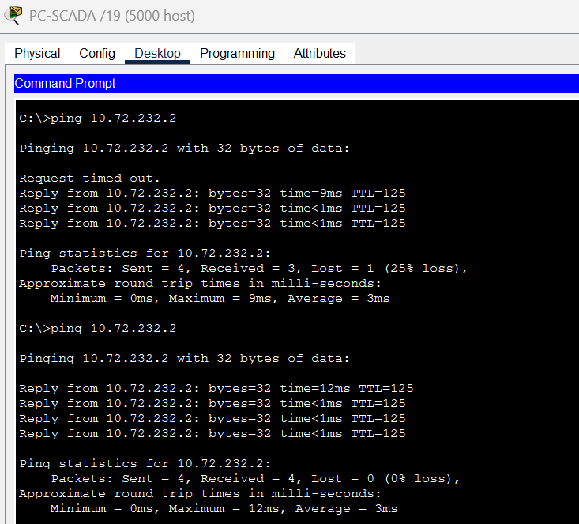
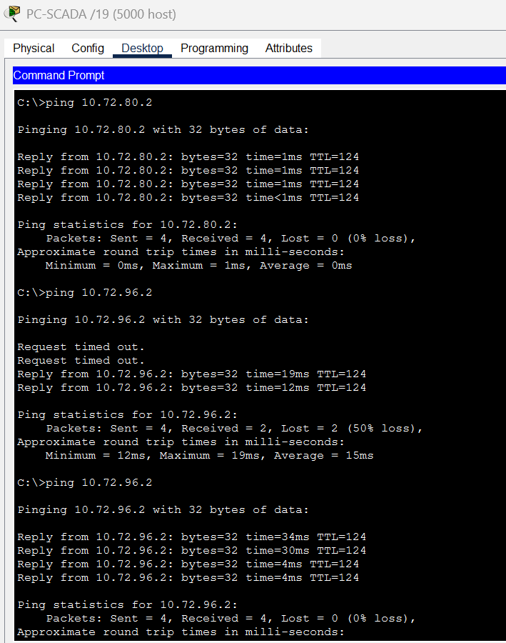
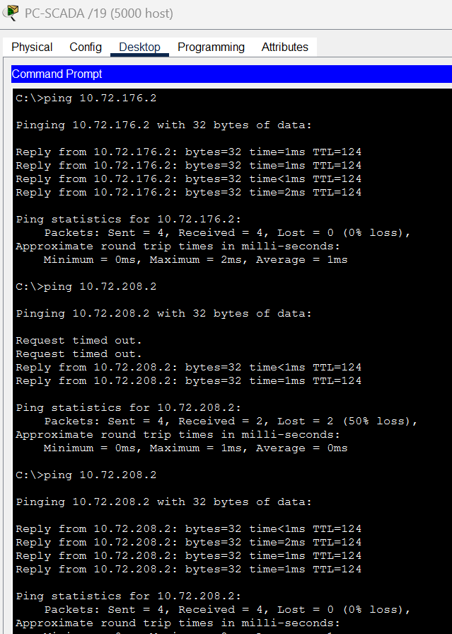
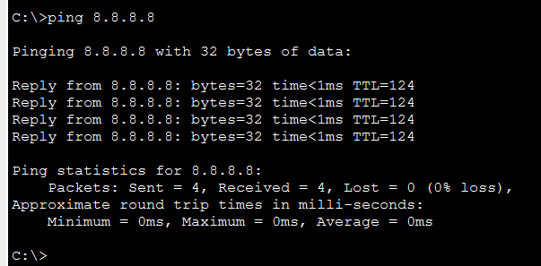
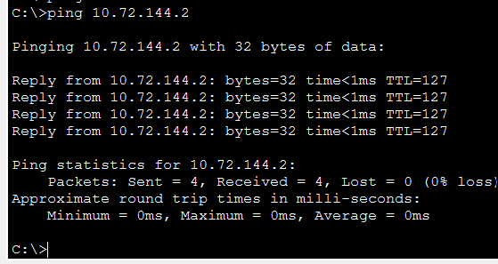
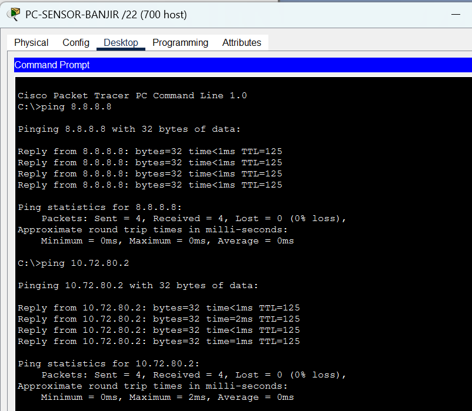

# Mid Projet Komdat & Jarkom

| No | Nama | NRP |
|:---:|---|---|
| 1 | Dira Muhammad Ilyas Shafar Anwar | 5027241033 |
| 2 | Elisabeth La Satta Sitorus | 5027251039 |
| 3 | Ahmad Nayottama Juliansyah | 5027251045 |

## 1. Topologi K09 - Cisco Packet Tracer


## 1.1. Desain Topologi & Alasan Pemilihan Skema VLSM
#### Desain Topologi
Topologi jaringan dirancang dan terbagi ke dalam beberapa lapisan fungsional:

1. `R-PUSAT`:
   Berperan sebagai pusat pertukaran lalu lintas seluruh wilayah sekaligus gerbang utama menuju jaringan eksternal (**`R-ISP`** $\rightarrow$ **`SERVER-INTERNET`** `8.8.8.8`). `R-PUSAT` juga melayani dua segmen lokal Balai Kota secara langsung melalui switch terpisah, yaitu **`SW-BALAIKOTA`** (`PC-PEGAWAI`) dan **`SW-SERVER-BK`** (`SRV-WEB-BK`).
2. **DBranch Layer (5 Router Wilayah):**
   Terdiri dari **`R-DC`**, **`R-BARAT`**, **`R-UTARA`**, **`R-TIMUR`**, dan **`R-SELATAN`** yang terhubung langsung secara *star/hub-and-spoke* ke `R-PUSAT` menggunakan tautan kabel *point-to-point* `/30`.
3. `R-PELABUHAN`:
   Berada satu tingkat di bawah **`R-UTARA`** melalui tautan `Gig1/0` $\leftrightarrow$ `Gig0/0`, sehingga secara fisik lalu lintas dari Pelabuhan menuju Pusat melewati `R-UTARA` sebagai *intermediary router*.
4. **Access & Wireless Layer:**
   Setiap router cabang memisahkan dua layanan jaringannya ke dua antarmuka fisik yang berbeda (masing-masing menggunakan Switch atau Access Point tersendiri) guna mengisolasi domain *broadcast*—seperti pemisahan antara jaringan layanan publik (`AP-WIFI-*`) dengan jaringan operasional/sensor (`SW-SENSOR-UTARA`, `SW-PUSKESMAS`, `SW-BANJIR`, `SW-PJU`, `SW-SCADA`, `SW-KANTOR-PELABUHAN`, `SW-CCTV-DC`, dan `SW-SERVER-DC`).
5. `GRE Tunnel0`:
   Menghubungkan `R-PUSAT` (`192.168.9.1/30`) dan `R-PELABUHAN` (`192.168.9.2/30`) secara langsung melalui antarmuka virtual `Tunnel0` untuk memangkas lompatan (*hop*) logis di atas infrastruktur fisik yang melewati `R-UTARA`.

#### Skema VLSM
Jaringan internal dialokasikan dari blok induk **`10.72.0.0/16`** menggunakan metode **VLSM** berdasarkan pertimbangan berikut:

1. **Perbedaan Kebutuhan Host yang Sangat Kontras:**
   Setiap segmen memiliki skala kebutuhan perangkat yang jauh berbeda—mulai dari jaringan Wi-Fi publik dan sensor perkotaan berskala besar (`/19` untuk ribuan host dan `/20` untuk ribuan host), jaringan pegawai balai kota (`/21`), jaringan server lokal (`/27` untuk puluhan host), hingga tautan *point-to-point* antar-router yang hanya membutuhkan **2 host valid (`/30`)**.
2. **Efisiensi Alokasi Alamat IP:**
   Jika menggunakan ukuran subnet yang seragam (misalnya semua memakai `/19`), maka tautan antar-router maupun jaringan server kecil akan membuang ribuan alamat IP secara percuma. VLSM menyesuaikan ukuran *subnet mask* tepat sesuai kapasitas tiap segmen.
3. **Pencegahan *Overlapping* & Skalabilitas:**
   Alokasi subnet diurutkan secara ketat dari **kebutuhan host terbesar ke terkecil** (`/19` $\rightarrow$ `/20` $\rightarrow$ `/21` $\rightarrow$ `/27` $\rightarrow$ `/30`), sehingga tidak ada blok IP yang saling bertabrakan dan masih menyisakan ruang alamat cadangan pada blok `10.72.0.0/16` untuk pengembangan wilayah baru di masa depan.


## 2. Konfigurasi Tabel Alokasi Subnet
#### A. Segmen LAN Internal (`10.72.0.0/16`)
| Wilayah / Subnet | Rute Subnet | Prefix | Subnet Mask | Network ID | Host Range | Broadcast ID |
| :--- | :--- | :---: | :--- | :--- | :--- | :--- |
| **R-UTARA** | WiFi Publik Utara | `/19` | `255.255.224.0` | `10.72.0.0` | `10.72.0.1 – 10.72.31.254` | `10.72.31.255` |
| **R-UTARA** | Sensor Lalu Lintas Utara | `/19` | `255.255.224.0` | `10.72.32.0` | `10.72.32.1 – 10.72.63.254` | `10.72.63.255` |
| **R-DC** | CCTV Kota | `/20` | `255.255.240.0` | `10.72.64.0` | `10.72.64.1 – 10.72.79.254` | `10.72.79.255` |
| **R-DC** | Server dan Storage DC | `/20` | `255.255.240.0` | `10.72.80.0` | `10.72.80.1 – 10.72.95.254` | `10.72.95.255` |
| **R-BARAT** | WiFi Publik Barat | `/20` | `255.255.240.0` | `10.72.96.0` | `10.72.96.1 – 10.72.111.254` | `10.72.111.255` |
| **R-BARAT** | Puskesmas dan Sekolah Barat | `/20` | `255.255.240.0` | `10.72.112.0` | `10.72.112.1 – 10.72.127.254` | `10.72.127.255` |
| **R-PELABUHAN** | Sensor & SCADA | `/20` | `255.255.240.0` | `10.72.128.0` | `10.72.128.1 – 10.72.143.254` | `10.72.143.255` |
| **R-PELABUHAN** | Kantor Pelabuhan | `/20` | `255.255.240.0` | `10.72.144.0` | `10.72.144.1 – 10.72.159.254` | `10.72.159.255` |
| **R-TIMUR** | WiFi Publik Timur | `/20` | `255.255.240.0` | `10.72.160.0` | `10.72.160.1 – 10.72.175.254` | `10.72.175.255` |
| **R-TIMUR** | Sensor Banjir Timur | `/20` | `255.255.240.0` | `10.72.176.0` | `10.72.176.1 – 10.72.191.254` | `10.72.191.255` |
| **R-SELATAN** | WiFi Publik Selatan | `/20` | `255.255.240.0` | `10.72.192.0` | `10.72.192.1 – 10.72.207.254` | `10.72.207.255` |
| **R-SELATAN** | PJU Pintar Selatan | `/20` | `255.255.240.0` | `10.72.208.0` | `10.72.208.1 – 10.72.223.254` | `10.72.223.255` |
| **R-PUSAT** | Pegawai Balai Kota | `/21` | `255.255.248.0` | `10.72.224.0` | `10.72.224.1 – 10.72.231.254` | `10.72.231.255` |
| **R-PUSAT** | Server Balai Kota | `/27` | `255.255.255.224` | `10.72.232.0` | `10.72.232.1 – 10.72.232.30` | `10.72.232.31` |

#### B. Segmen Link Point-to-Point Antar-Router (`/30`), ISP & GRE Tunnel (K = 9)
| Segmen | Interface Terhubung | Prefix | Subnet Mask | Network ID | Alamat IP Terpasang |
| :--- | :--- | :---: | :--- | :--- | :--- |
| **R-PUSAT $\leftrightarrow$ R-DC** | `Fa1/1` $\leftrightarrow$ `Gig0/0` | `/30` | `255.255.255.252` | `10.72.254.0` | `.1` (Pusat) \| `.2` (DC) |
| **R-PUSAT $\leftrightarrow$ R-BARAT** | `Eth0/0/0` $\leftrightarrow$ `Gig0/0` | `/30` | `255.255.255.252` | `10.72.254.4` | `.5` (Pusat) \| `.6` (Barat) |
| **R-PUSAT $\leftrightarrow$ R-UTARA** | `Eth0/1/0` $\leftrightarrow$ `Gig0/0` | `/30` | `255.255.255.252` | `10.72.254.8` | `.9` (Pusat) \| `.10` (Utara) |
| **R-PUSAT $\leftrightarrow$ R-TIMUR** | `Eth0/2/0` $\leftrightarrow$ `Gig0/0` | `/30` | `255.255.255.252` | `10.72.254.12` | `.13` (Pusat) \| `.14` (Timur) |
| **R-PUSAT $\leftrightarrow$ R-SELATAN** | `Eth0/3/0` $\leftrightarrow$ `Gig0/0` | `/30` | `255.255.255.252` | `10.72.254.16` | `.17` (Pusat) \| `.18` (Selatan) |
| **R-UTARA $\leftrightarrow$ R-PELABUHAN** | `Gig1/0` $\leftrightarrow$ `Gig0/0` | `/30` | `255.255.255.252` | `10.72.254.20` | `.21` (Utara) \| `.22` (Pelabuhan) |
| **R-PUSAT $\leftrightarrow$ R-ISP** (K=9) | `Fa0/0` $\leftrightarrow$ `Gig0/0` | `/30` | `255.255.255.252` | `203.0.113.36` | `.37` (Pusat) \| `.38` (ISP) |
| **GRE Tunnel0** (K=9) | `Tunnel0` Pusat $\leftrightarrow$ Pelabuhan | `/30` | `255.255.255.252` | `192.168.9.0` | `.1` (Pusat) \| `.2` (Pelabuhan) |
| **Internet Eksternal** | `R-ISP Gig0/1` $\leftrightarrow$ `SERVER-INTERNET` | `/24` | `255.255.255.0` | `8.8.8.0` | `.1` (ISP) \| `.8` (Server) |

---

Untuk tabel lengkapnya, dapat dilihat di file `Subnetting_K9.xls`

## 3. Static Routing

#### 3.1. Default Route & Static Route
1. **Default Route (`0.0.0.0/0`) — Jalur Arah Keluar:**
   * Diterapkan pada router cabang dan router pusat untuk meneruskan seluruh paket yang tujuannya tidak berada di jaringan lokalnya (baik menuju cabang lain maupun ke Internet `8.8.8.8`) **ke satu tingkat router di atasnya**.
   * **Alasan & Manfaat:** Router cabang di lapisan bawah (`R-DC`, `R-BARAT`, `R-TIMUR`, `R-SELATAN`, dan `R-PELABUHAN`) tidak perlu menyimpan daftar belasan jaringan milik cabang lain. Cukup dengan satu entri *default route* ke atas, ukuran tabel routing tetap ringkas dan mencegah terjadinya *routing loop* dengan router di atasnya.
   * **Arah Default Route Tiap Router:**
     * `R-PELABUHAN` $\rightarrow$ ke atas menuju `R-UTARA` (`10.72.254.21`)
     * `R-UTARA` $\rightarrow$ ke atas menuju `R-PUSAT` (`10.72.254.9`)
     * `R-DC`, `R-BARAT`, `R-TIMUR`, `R-SELATAN` $\rightarrow$ ke atas menuju `R-PUSAT` (`10.72.254.1`, `.5`, `.13`, `.17`)
     * `R-PUSAT` $\rightarrow$ ke luar menuju `R-ISP` (`203.0.113.38`)

2. **Static Route Spesifik — Jalur Arah Masuk:**
   * Karena *default route* hanya boleh mengarah ke atas/keluar, router yang berada di lapisan distribusi dan inti (`R-UTARA`, `R-PUSAT`, dan `R-ISP`) wajib memiliki daftar **Static Route** spesifik untuk mengetahui jalur turun menuju jaringan LAN di bawahnya.
   * **Cakupan Static Route Tiap Router:**
     * **`R-UTARA`:** Menyimpan rute statis menuju 2 subnet LAN milik `R-PELABUHAN` (`10.72.128.0/20` dan `10.72.144.0/20`) melalui *next-hop* `10.72.254.22`.
     * **`R-PUSAT`:** Menyimpan rute statis menuju **seluruh 12 subnet LAN cabang** (`R-UTARA`, `R-DC`, `R-BARAT`, `R-PELABUHAN`, `R-TIMUR`, dan `R-SELATAN`) serta segmen tautan `10.72.254.20/30` melalui *next-hop* masing-masing router cabang.
     * **`R-ISP`:** Menyimpan rute statis balik (*summary route*) `10.72.0.0/16` menuju `R-PUSAT` (`203.0.113.37`) agar paket balasan dari `SERVER-INTERNET` (`8.8.8.8`) dapat kembali ke seluruh LAN internal.

#### 3.2. Tabel Routing
| Router | Peran Hierarki | Jenis Rute | Network Tujuan | Next-Hop IP | Arah |
| :--- | :--- | :--- | :--- | :--- | :--- |
| **`R-PELABUHAN`** | Leaf / Cabang Bawah | Default (`S*`) | `0.0.0.0/0` | `10.72.254.21` | Naik ke `R-UTARA` |
| **`R-UTARA`** | Distribusi / Transit | Default (`S*`) | `0.0.0.0/0` | `10.72.254.9` | Naik ke `R-PUSAT` |
| | | Static (`S`) | `10.72.128.0/20`, `10.72.144.0/20` | `10.72.254.22` | Turun ke LAN `R-PELABUHAN` |
| **`R-DC`** | Cabang | Default (`S*`) | `0.0.0.0/0` | `10.72.254.1` | Naik ke `R-PUSAT` |
| **`R-BARAT`** | Cabang | Default (`S*`) | `0.0.0.0/0` | `10.72.254.5` | Naik ke `R-PUSAT` |
| **`R-TIMUR`** | Cabang | Default (`S*`) | `0.0.0.0/0` | `10.72.254.13` | Naik ke `R-PUSAT` |
| **`R-SELATAN`** | Cabang | Default (`S*`) | `0.0.0.0/0` | `10.72.254.17` | Naik ke `R-PUSAT` |
| **`R-PUSAT`** | Core Router | Default (`S*`) | `0.0.0.0/0` | `203.0.113.38` | Keluar ke `R-ISP` |
| | | Static (`S`) | 12 Subnet LAN Cabang + Link `/30` | `.2`, `.6`, `.10`, `.14`, `.18` | Turun ke seluruh cabang |
| **`R-ISP`** | Gateway Eksternal | Static (`S`) | `10.72.0.0/16` | `203.0.113.37` | Masuk kembali ke `R-PUSAT` |

**POV `R-PUSAT`:**  
  


#### 3.3. Uji ping
Berikut hasil uji ping dari Segmen LAN `R-PELABUHAN` (PC Scada) ke seluruh LAN, di sini kami mengambil salah satu IP perwakilan tiap segmen LAN.

  
  
  
  
  
  


Beberapa ping harus dilakukan 2 kali, karena saat ping pertama biasanya akan terjadi *Request Timed Out* disebabkan oleh PC sender dan router harus menjalankan proses ARP terlebih dahulu. Karena itu, saat proses ARP sudah selesai dilakukan, ping ke-2 akan berhasil dan berstatus `Reply..`

#### 3.4. Konfigurasi Router
```ios
# R-PUSAT (Default Route ke ISP + Static Route ke 12 LAN Cabang)
ip route 0.0.0.0 0.0.0.0 203.0.113.38
ip route 10.72.0.0 255.255.224.0 10.72.254.10
ip route 10.72.32.0 255.255.224.0 10.72.254.10
ip route 10.72.64.0 255.255.240.0 10.72.254.2
ip route 10.72.80.0 255.255.240.0 10.72.254.2
ip route 10.72.96.0 255.255.240.0 10.72.254.6
ip route 10.72.112.0 255.255.240.0 10.72.254.6
ip route 10.72.128.0 255.255.240.0 10.72.254.10
ip route 10.72.144.0 255.255.240.0 10.72.254.10
ip route 10.72.160.0 255.255.240.0 10.72.254.14
ip route 10.72.176.0 255.255.240.0 10.72.254.14
ip route 10.72.192.0 255.255.240.0 10.72.254.18
ip route 10.72.208.0 255.255.240.0 10.72.254.18
ip route 10.72.254.20 255.255.255.252 10.72.254.10

# R-UTARA (Default Route ke Pusat + Static Route ke LAN Pelabuhan)
ip route 0.0.0.0 0.0.0.0 10.72.254.9
ip route 10.72.128.0 255.255.240.0 10.72.254.22
ip route 10.72.144.0 255.255.240.0 10.72.254.22

# Router Cabang Lainnya (Hanya Default Route ke Atas)
! R-PELABUHAN: ip route 0.0.0.0 0.0.0.0 10.72.254.21
! R-DC:        ip route 0.0.0.0 0.0.0.0 10.72.254.1
! R-BARAT:     ip route 0.0.0.0 0.0.0.0 10.72.254.5
! R-TIMUR:     ip route 0.0.0.0 0.0.0.0 10.72.254.13
! R-SELATAN:   ip route 0.0.0.0 0.0.0.0 10.72.254.17

# R-ISP (Rute Balik ke Jaringan Internal)
ip route 10.72.0.0 255.255.0.0 203.0.113.37
```

## 4. Konfigurasi DHCP & DHCP Relay

#### 4.1. Desain Layanan DHCP & Alokasi Pool

Layanan Dynamic Host Configuration Protocol (DHCP) dirancang agar seluruh perangkat pengguna akhir (PC dan Smartphone) di setiap wilayah memperoleh alamat IP dinamis, Subnet Mask, Default Gateway, serta DNS Server secara otomatis tanpa bertabrakan dengan alamat IP statis perangkat jaringan:

1. **Pengecualian Alamat Statis (Excluded Address):**
   * Sepuluh alamat host pertama pada setiap subnet LAN (.1 hingga .10) dikecualikan dari distribusi DHCP menggunakan perintah `ip dhcp excluded-address`.
   * Langkah ini menjamin alamat Default Gateway (.1) serta alamat IP statis milik server lokal (seperti SRV-DC di 10.72.80.2 dan SRV-WEB-BK di 10.72.232.2) tidak disewakan kepada perangkat klien.
2. **Distribusi DHCP Lokal pada Router Wilayah:**
   * Enam router (R-PUSAT, R-BARAT, R-UTARA, R-TIMUR, R-SELATAN, dan R-PELABUHAN) dikonfigurasi sebagai DHCP Server lokal bagi segmen LAN yang terhubung langsung di bawahnya.
   * Segmen LAN Server Balai Kota (10.72.232.0/27) dan LAN Server dan Storage DC (10.72.80.0/20) tidak diberikan DHCP Pool karena seluruh server wajib menggunakan alamat IP statis.
3. **Mekanisme DHCP Relay Khusus Segmen CCTV Kota (R-DC):**
   * Sesuai ketentuan penugasan, perangkat pada subnet CCTV Kota (10.72.64.0/20) di bawah R-DC tidak memperoleh alamat IP dari router R-DC, melainkan dari layanan DHCP terpusat pada SRV-DC (10.72.80.2) di segmen LAN Server dan Storage DC.
   * Karena paket DHCP Discover dikirimkan oleh klien secara broadcast (255.255.255.255) dan tidak dapat melintasi router secara langsung, antarmuka GigabitEthernet0/1 pada R-DC dikonfigurasi menggunakan perintah `ip helper-address 10.72.80.2`.
   * Saat R-DC menerima paket broadcast DHCP dari PC-CCTV-KOTA, R-DC membungkus dan meneruskannya secara unicast menuju SRV-DC (10.72.80.2), kemudian mengembalikan penawaran alamat IP dari POOL-CCTV-KOTA kepada PC-CCTV-KOTA.

#### 4.2. Tabel Alokasi DHCP Pool

| Perangkat Penyedia | Nama Pool | Segmen Layanan | Network & Prefix | Rentang IP Dinamis |
|---|---|---|---|---|
| **R-PUSAT** | POOL-PEGAWAI-BK | Pegawai Balai Kota | 10.72.224.0/21 | 10.72.224.11 - 10.72.231.254 |
| **SRV-DC** (Relay R-DC) | POOL-CCTV-KOTA | CCTV Kota | 10.72.64.0/20 | 10.72.64.11 - 10.72.79.254 |
| **R-BARAT** | POOL-BARAT-1 | WiFi Publik Barat | 10.72.96.0/20 | 10.72.96.11 - 10.72.111.254 |
| **R-BARAT** | POOL-BARAT-2 | Puskesmas & Sekolah | 10.72.112.0/20 | 10.72.112.11 - 10.72.127.254 |
| **R-UTARA** | POOL-UTARA-1 | WiFi Publik Utara | 10.72.0.0/19 | 10.72.0.11 - 10.72.31.254 |
| **R-UTARA** | POOL-UTARA-2 | Sensor Lalin Utara | 10.72.32.0/19 | 10.72.32.11 - 10.72.63.254 |
| **R-TIMUR** | POOL-TIMUR-1 | WiFi Publik Timur | 10.72.160.0/20 | 10.72.160.11 - 10.72.175.254 |
| **R-TIMUR** | POOL-TIMUR-2 | Sensor Banjir Timur | 10.72.176.0/20 | 10.72.176.11 - 10.72.191.254 |
| **R-SELATAN** | POOL-SELATAN-1 | WiFi Publik Selatan | 10.72.192.0/20 | 10.72.192.11 - 10.72.207.254 |
| **R-SELATAN** | POOL-SELATAN-2 | PJU Pintar Selatan | 10.72.208.0/20 | 10.72.208.11 - 10.72.223.254 |
| **R-PELABUHAN** | POOL-PELABUHAN-1 | Sensor & SCADA | 10.72.128.0/20 | 10.72.128.11 - 10.72.143.254 |
| **R-PELABUHAN** | POOL-PELABUHAN-2 | Kantor Pelabuhan | 10.72.144.0/20 | 10.72.144.11 - 10.72.159.254 |

Seluruh DHCP Pool di atas mengecualikan sepuluh alamat host pertama (.1 hingga .10), menetapkan alamat host pertama (.1) pada masing-masing subnet sebagai Default Gateway, serta mendistribusikan alamat DNS Server 10.72.80.2 dan nama domain k9.smartcity.lab.

#### 4.3. Uji Coba Request DHCP & Verifikasi Lease

Berikut adalah hasil pengujian permintaan ulang alamat IP menggunakan perintah `ipconfig /release` dan `ipconfig /renew` pada klien LAN wilayah serta verifikasi DHCP Relay dan sewa (lease) IP pada segmen CCTV Kota:

**Request Ulang Klien LAN (PC-PEGAWAI & PC-PUSKESMAS):**


**Konfigurasi Pool DHCP pada SRV-DC & Verifikasi Helper Address R-DC:**


**Penerimaan Lease IP pada PC-CCTV-KOTA:**


Berdasarkan pengujian di atas, PC-CCTV-KOTA berhasil melepas alamat IP lama saat `ipconfig /release` dan menerima sewa baru berupa IP Address 10.72.64.12, Subnet Mask 255.255.240.0, Default Gateway 10.72.64.1, serta DNS Server 10.72.80.2 saat `ipconfig /renew` yang bersumber dari SRV-DC melalui bantuan relay R-DC.

#### 4.4. Konfigurasi Router

```ios
# R-DC (DHCP Relay menuju Server DC 10.72.80.2 untuk LAN CCTV Kota)
interface GigabitEthernet0/1
 ip helper-address 10.72.80.2
 exit

# R-PUSAT (DHCP Pool Pegawai Balai Kota)
ip dhcp excluded-address 10.72.224.1 10.72.224.10
ip dhcp pool POOL-PEGAWAI-BK
 network 10.72.224.0 255.255.248.0
 default-router 10.72.224.1
 dns-server 10.72.80.2
 domain-name k9.smartcity.lab
 exit

# R-BARAT (DHCP Pool WiFi Publik Barat & Puskesmas)
ip dhcp excluded-address 10.72.96.1 10.72.96.10
ip dhcp excluded-address 10.72.112.1 10.72.112.10
ip dhcp pool POOL-BARAT-1
 network 10.72.96.0 255.255.240.0
 default-router 10.72.96.1
 dns-server 10.72.80.2
 domain-name k9.smartcity.lab
ip dhcp pool POOL-BARAT-2
 network 10.72.112.0 255.255.240.0
 default-router 10.72.112.1
 dns-server 10.72.80.2
 domain-name k9.smartcity.lab
 exit

# R-UTARA (DHCP Pool WiFi Publik Utara & Sensor Lalu Lintas)
ip dhcp excluded-address 10.72.0.1 10.72.0.10
ip dhcp excluded-address 10.72.32.1 10.72.32.10
ip dhcp pool POOL-UTARA-1
 network 10.72.0.0 255.255.224.0
 default-router 10.72.0.1
 dns-server 10.72.80.2
 domain-name k9.smartcity.lab
ip dhcp pool POOL-UTARA-2
 network 10.72.32.0 255.255.224.0
 default-router 10.72.32.1
 dns-server 10.72.80.2
 domain-name k9.smartcity.lab
 exit

# R-TIMUR (DHCP Pool WiFi Publik Timur & Sensor Banjir)
ip dhcp excluded-address 10.72.160.1 10.72.160.10
ip dhcp excluded-address 10.72.176.1 10.72.176.10
ip dhcp pool POOL-TIMUR-1
 network 10.72.160.0 255.255.240.0
 default-router 10.72.160.1
 dns-server 10.72.80.2
 domain-name k9.smartcity.lab
ip dhcp pool POOL-TIMUR-2
 network 10.72.176.0 255.255.240.0
 default-router 10.72.176.1
 dns-server 10.72.80.2
 domain-name k9.smartcity.lab
 exit

# R-SELATAN (DHCP Pool WiFi Publik Selatan & PJU Pintar)
ip dhcp excluded-address 10.72.192.1 10.72.192.10
ip dhcp excluded-address 10.72.208.1 10.72.208.10
ip dhcp pool POOL-SELATAN-1
 network 10.72.192.0 255.255.240.0
 default-router 10.72.192.1
 dns-server 10.72.80.2
 domain-name k9.smartcity.lab
ip dhcp pool POOL-SELATAN-2
 network 10.72.208.0 255.255.240.0
 default-router 10.72.208.1
 dns-server 10.72.80.2
 domain-name k9.smartcity.lab
 exit

# R-PELABUHAN (DHCP Pool Sensor SCADA & Kantor Pelabuhan)
ip dhcp excluded-address 10.72.128.1 10.72.128.10
ip dhcp excluded-address 10.72.144.1 10.72.144.10
ip dhcp pool POOL-PELABUHAN-1
 network 10.72.128.0 255.255.240.0
 default-router 10.72.128.1
 dns-server 10.72.80.2
 domain-name k9.smartcity.lab
ip dhcp pool POOL-PELABUHAN-2
 network 10.72.144.0 255.255.240.0
 default-router 10.72.144.1
 dns-server 10.72.80.2
 domain-name k9.smartcity.lab
 exit
```

## 5. Network Address Translation (NAT Overload / PAT)

#### 5.1. Desain NAT Overload (PAT) & Isolasi Rute Privat R-ISP

Agar seluruh perangkat di dalam jaringan privat Smart City (10.72.0.0/16 dan 192.168.9.0/30) dapat mengakses SERVER-INTERNET (8.8.8.8) menggunakan satu alamat IP publik milik R-PUSAT (203.0.113.37), diterapkan skema NAT Overload atau Port Address Translation (PAT) pada R-PUSAT:

1. **Translasi Banyak-ke-Satu Berbasis Nomor Port (PAT):**
   * Seluruh paket dari jaringan internal yang diizinkan oleh Access Control List (ACL 1) dan keluar melewati antarmuka eksternal FastEthernet0/0 pada R-PUSAT diterjemahkan alamat sumbernya dari IP privat (Inside Local) menjadi satu IP publik 203.0.113.37 (Inside Global) dengan nomor port unik untuk setiap sesi.
   * Ketika paket balasan dari 8.8.8.8 tiba di 203.0.113.37, R-PUSAT memeriksa tabel translasi NAT untuk memetakan kembali nomor port tujuan ke alamat IP privat pengirim awal.
2. **Penghapusan Rute Privat pada R-ISP:**
   * Sesuai ketentuan bahwa R-ISP tidak boleh memiliki rute menuju alamat privat internal, entri rute statis balik sementara (`ip route 10.72.0.0 255.255.0.0 203.0.113.37`) yang sebelumnya dipasang pada tahap uji dasar static routing dihapus dari R-ISP.
   * Dengan berjalannya NAT Overload di R-PUSAT, R-ISP cukup mengenali jaringan publik 203.0.113.36/30 dan 8.8.8.0/24 yang terhubung langsung (Directly Connected) untuk mengembalikan paket balasan ke 203.0.113.37.

#### 5.2. Tabel Pemetaan Interface NAT pada R-PUSAT

| Peran NAT | Interface R-PUSAT | Segmen Jaringan | Alamat IP Interface |
|---|---|---|---|
| **ip nat outside** | FastEthernet0/0 | Link Eksternal ke R-ISP | 203.0.113.37/30 |
| **ip nat inside** | FastEthernet0/1 | LAN Pegawai Balai Kota | 10.72.224.1/21 |
| **ip nat inside** | FastEthernet1/0 | LAN Server Balai Kota | 10.72.232.1/27 |
| **ip nat inside** | FastEthernet1/1 | Link menuju R-DC | 10.72.254.1/30 |
| **ip nat inside** | Ethernet0/0/0 | Link menuju R-BARAT | 10.72.254.5/30 |
| **ip nat inside** | Ethernet0/1/0 | Link menuju R-UTARA | 10.72.254.9/30 |
| **ip nat inside** | Ethernet0/2/0 | Link menuju R-TIMUR | 10.72.254.13/30 |
| **ip nat inside** | Ethernet0/3/0 | Link menuju R-SELATAN | 10.72.254.17/30 |
| **ip nat inside** | Tunnel0 | Jalur GRE ke R-PELABUHAN | 192.168.9.1/30 |

Pemetaan di atas memastikan baik lalu lintas reguler dari seluruh router cabang maupun lalu lintas yang keluar dari antarmuka virtual Tunnel0 tetap diterjemahkan oleh R-PUSAT saat mengakses 8.8.8.8.

#### 5.3. Uji Konektivitas Internet & Verifikasi Translasi NAT

Berikut adalah hasil pengujian `ping 8.8.8.8` dan `tracert 8.8.8.8` dari beberapa wilayah, verifikasi tabel translasi NAT pada R-PUSAT, serta verifikasi tabel routing pada R-ISP:

**Ping & Traceroute ke 8.8.8.8 dari Klien Wilayah:**


**Tabel Translasi & Rule NAT pada R-PUSAT (`show ip nat translations`):**


**Tabel Routing R-ISP Tanpa Rute Privat (`show ip route`):**


Hasil pengujian menunjukkan seluruh klien berhasil menerima balasan dari 8.8.8.8, alamat privat klien tercatat berubah menjadi 203.0.113.37 pada tabel `show ip nat translations` di R-PUSAT, dan tabel routing R-ISP bersih dari blok alamat privat 10.72.0.0/16.

#### 5.4. Konfigurasi Router

```ios
# R-PUSAT (Konfigurasi ACL, Interface NAT Inside/Outside, dan NAT Overload)
access-list 1 permit 10.72.0.0 0.0.255.255
access-list 1 permit 192.168.9.0 0.0.0.3
!
interface FastEthernet0/0
 ip nat outside
interface FastEthernet0/1
 ip nat inside
interface FastEthernet1/0
 ip nat inside
interface FastEthernet1/1
 ip nat inside
interface Ethernet0/0/0
 ip nat inside
interface Ethernet0/1/0
 ip nat inside
interface Ethernet0/2/0
 ip nat inside
interface Ethernet0/3/0
 ip nat inside
interface Tunnel0
 ip nat inside
 exit
!
ip nat inside source list 1 interface FastEthernet0/0 overload

# R-ISP (Menghapus Rute Balik ke Blok Privat Internal)
no ip route 10.72.0.0 255.255.0.0 203.0.113.37
```

## 6. Tunnel GRE (Generic Routing Encapsulation)

#### 6.1. Pemilihan Jalur Tunnel & Cara Kerja Enkapsulasi GRE

1. **Mengapa Router Memilih Jalur Tunnel Dibandingkan Jalur Fisik Biasa ke Pelabuhan?**
   * **Dari Sisi R-PELABUHAN Menuju Balai Kota (Prinsip Longest Prefix Match):** Pada kondisi awal, R-PELABUHAN mengandalkan Default Route (0.0.0.0/0 via 10.72.254.21 menuju R-UTARA) untuk seluruh trafik keluar. Ketika ditambahkan rute statis spesifik menuju kedua subnet Balai Kota (10.72.224.0/21 dan 10.72.232.0/27) dengan next-hop IP Tunnel0 milik R-PUSAT (192.168.9.1), router membandingkan panjang prefix di tabel routing. Berdasarkan hukum Longest Prefix Match, router selalu memilih rute dengan subnet mask paling spesifik (/21 dan /27 lebih panjang daripada /0), sehingga lalu lintas menuju Balai Kota otomatis masuk ke jalur Tunnel0 tanpa mengganggu Default Route ke cabang lain.
   * **Dari Sisi R-PUSAT Menuju Pelabuhan:** Pada R-PUSAT, rute statis untuk kedua subnet LAN Pelabuhan (10.72.128.0/20 dan 10.72.144.0/20) diarahkan ke next-hop Tunnel0 milik R-PELABUHAN (192.168.9.2). Sementara itu, paket pengantar tunnel (underlay menuju 10.72.254.22) tetap melewati rute statis fisik 10.72.254.20/30 via 10.72.254.10 (R-UTARA), sehingga terhindar dari recursive routing loop.
2. **Cara Kerja Enkapsulasi GRE & Mengapa GRE Saja Tidak Mengenkripsi Data:**
   * **Cara Kerja Enkapsulasi GRE:** Saat paket dikirimkan dari PC-PEGAWAI (10.72.224.11) menuju PC-SCADA (10.72.128.11), antarmuka Tunnel0 di R-PUSAT membungkus paket IP asli (Inner IP Packet) dengan menambahkan GRE Header (4 byte) serta Outer IP Header baru (20 byte) yang memiliki IP sumber 10.72.254.9 dan IP tujuan 10.72.254.22. Router transit (R-UTARA) hanya memproses Outer IP Header tersebut secara fisik tanpa membaca isi jaringan virtual di dalamnya. Ketika paket tiba di R-PELABUHAN (10.72.254.22), Outer IP Header dan GRE Header dilepas (de-encapsulation) lalu paket asli diteruskan ke PC-SCADA.
   * **Mengapa GRE Saja Tidak Mengenkripsi Data:** GRE (IP Protocol 47) dirancang murni sebagai protokol pembungkus (tunneling/encapsulation) untuk menghubungkan dua jaringan secara point-to-point di atas infrastruktur perantara, bukan sebagai protokol keamanan kriptografi. GRE tidak memiliki mekanisme pertukaran kunci (seperti ISAKMP/IKE), verifikasi integritas (seperti SHA/HMAC), maupun algoritma penyandian data (seperti AES/3DES). Akibatnya, seluruh isi paket di dalam bungkusan GRE tetap berformat teks terbuka (plaintext) dan dapat dibaca apabila disadap di sepanjang jalur fisik.
   * **Catatan Pengujian Bonus IPsec pada Simulator:** Konfigurasi enkripsi GRE over IPsec (`crypto isakmp policy`, `crypto ipsec transform-set`, dan `crypto map`) telah diuji coba pada kedua router. Perangkat R-PUSAT (Router-PT) mendukung penuh perintah kriptografi IPsec, namun perangkat R-PELABUHAN (Cisco 2911) di Cisco Packet Tracer menolak sub-perintah `crypto isakmp` dan `crypto ipsec` meskipun lisensi modul `securityk9` telah diaktifkan dan router telah di-reload. Oleh sebab itu, agar komunikasi dua arah pada Tunnel0 tidak terputus akibat ketidakcocokan Security Association (SA), konfigurasi `crypto map` pada R-PUSAT dilepas kembali.

#### 6.2. Tabel Parameter Tunnel GRE (K = 9)

| Parameter Tunnel | Sisi R-PUSAT (Balai Kota) | Sisi R-PELABUHAN (Pelabuhan) |
|---|---|---|
| **Interface Virtual** | Tunnel0 | Tunnel0 |
| **Alamat IP Tunnel (/30)** | 192.168.9.1 (255.255.255.252) | 192.168.9.2 (255.255.255.252) |
| **Tunnel Source (Fisik)** | Ethernet0/1/0 (10.72.254.9) | GigabitEthernet0/0 (10.72.254.22) |
| **Tunnel Destination** | 10.72.254.22 | 10.72.254.9 |
| **Protokol & MTU** | GRE/IP (MTU 1476 bytes) | GRE/IP (MTU 1476 bytes) |
| **Rute LAN via Tunnel** | 10.72.128.0/20 & 10.72.144.0/20 via 192.168.9.2 | 10.72.224.0/21 & 10.72.232.0/27 via 192.168.9.1 |

Tabel di atas merangkum pasangan titik ujung (endpoint) fisik dan alamat logis `/30` yang membentuk jalur virtual langsung antara Balai Kota dan Pelabuhan.

#### 6.3. Verifikasi Status Tunnel0 & Uji Traceroute

Berikut adalah bukti status antarmuka Tunnel0 pada R-PUSAT dan R-PELABUHAN serta hasil pengujian `tracert 10.72.128.11` dari PC-PEGAWAI di Balai Kota menuju PC-SCADA di Pelabuhan:

**Status & Konfigurasi Tunnel0 pada R-PUSAT dan R-PELABUHAN (`show interface Tunnel0`):**


**Uji Traceroute dari Balai Kota (PC-PEGAWAI) ke Pelabuhan (PC-SCADA 10.72.128.11):**


Pada output `show interface Tunnel0`, status antarmuka menunjukkan `Tunnel0 is up, line protocol is up (connected)` dengan protokol `GRE/IP`. Hasil `tracert 10.72.128.11` membuktikan paket bergerak dari gateway R-PUSAT (10.72.224.1) pada hop ke-1, langsung masuk ke IP Tunnel0 milik R-PELABUHAN (192.168.9.2) pada hop ke-2 tanpa memunculkan hop fisik R-UTARA (10.72.254.10), dan mencapai PC-SCADA (10.72.128.11) pada hop ke-3.

#### 6.4. Konfigurasi Router

```ios
# R-PUSAT (Konfigurasi Interface Tunnel0 & Rute LAN Pelabuhan via Tunnel)
interface Tunnel0
 ip address 192.168.9.1 255.255.255.252
 ip nat inside
 tunnel source Ethernet0/1/0
 tunnel destination 10.72.254.22
 exit
!
no ip route 10.72.128.0 255.255.240.0 10.72.254.10
no ip route 10.72.144.0 255.255.240.0 10.72.254.10
ip route 10.72.128.0 255.255.240.0 192.168.9.2
ip route 10.72.144.0 255.255.240.0 192.168.9.2

# R-PELABUHAN (Konfigurasi Interface Tunnel0 & Rute Spesifik ke Balai Kota via Tunnel)
interface Tunnel0
 ip address 192.168.9.2 255.255.255.252
 tunnel source GigabitEthernet0/0
 tunnel destination 10.72.254.9
 exit
!
ip route 10.72.224.0 255.255.248.0 192.168.9.1
ip route 10.72.232.0 255.255.255.224 192.168.9.1
```

