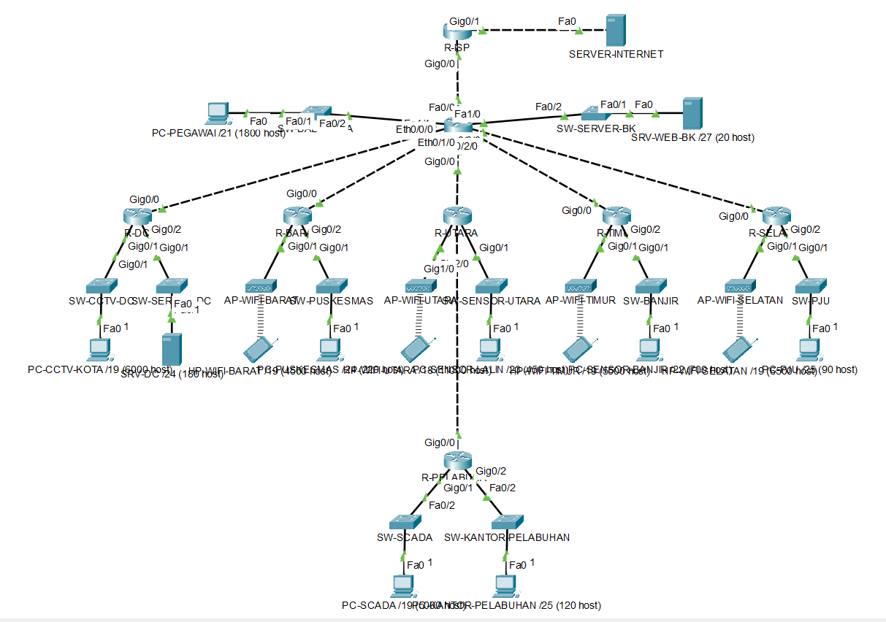
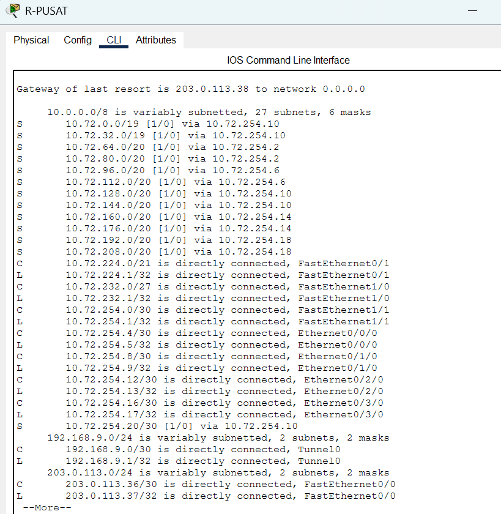
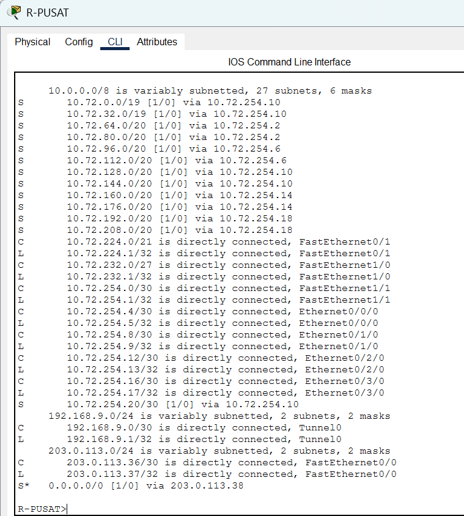
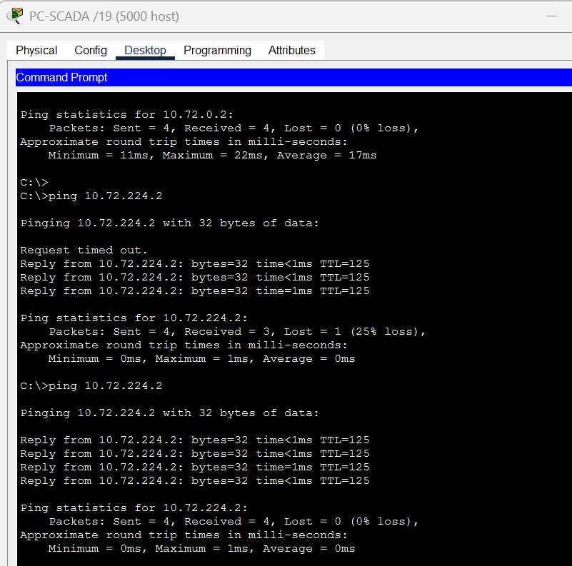
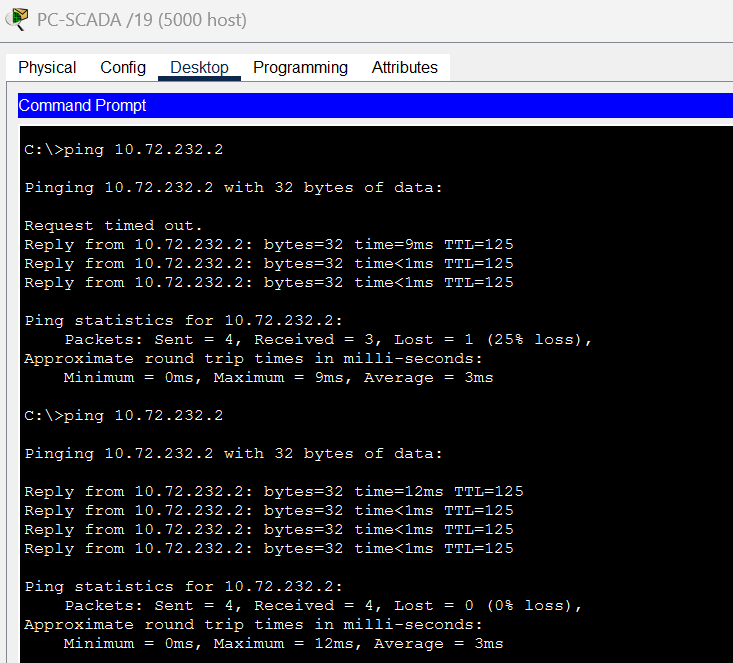
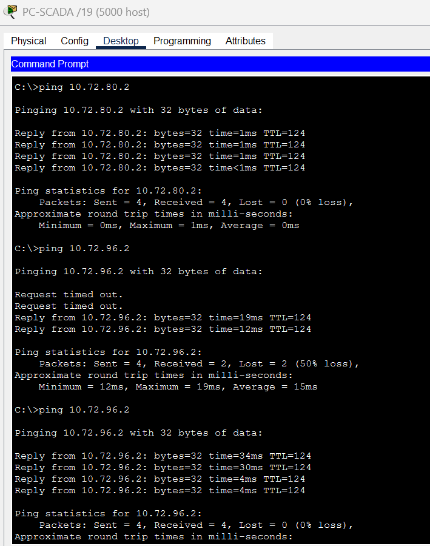
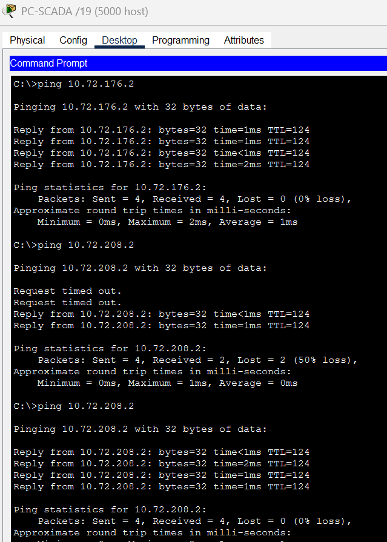
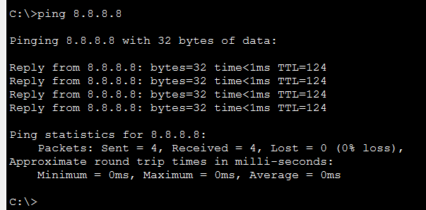
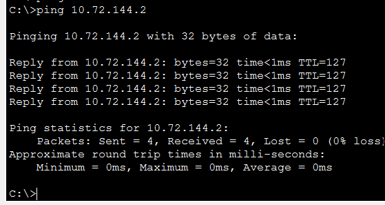
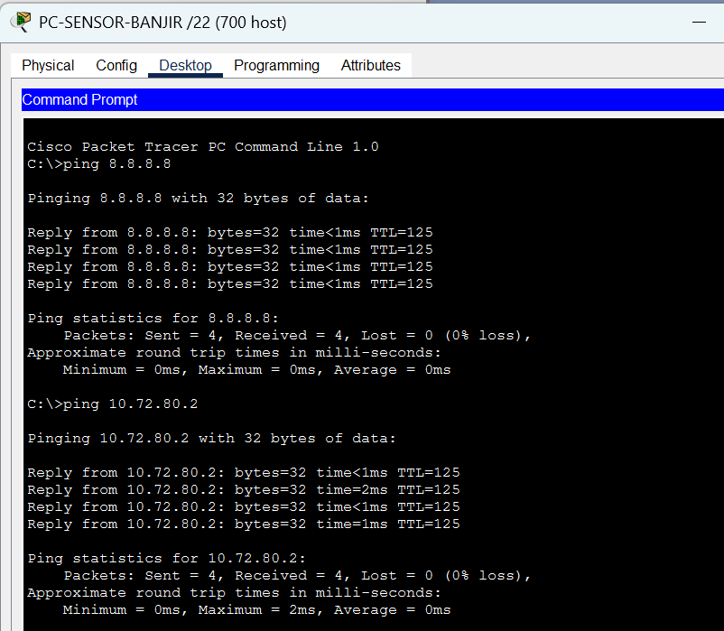

# Mid Projet Komdat & Jarkom

| No | Nama | NRP |
|:---:|---|---|
| 1 | Dira Muhammad Ilyas Shafar Anwar | 5027241033 |
| 2 | Elisabeth La Satta Sitorus | 5027251039 |
| 3 | Ahmad Nayottama Juliansyah | 5027251045 |

## 1. Topologi K09 - Cisco Packet Tracer


## 1.1. Desain Topologi & Alasan Pemilihan Skema VLSM
#### Desain Topologi
Topologi jaringan dirancang dan terbagi ke dalam beberapa lapisan fungsional:

1. `R-PUSAT`:
   Berperan sebagai pusat pertukaran lalu lintas seluruh wilayah sekaligus gerbang utama menuju jaringan eksternal (**`R-ISP`** $\rightarrow$ **`SERVER-INTERNET`** `8.8.8.8`). `R-PUSAT` juga melayani dua segmen lokal Balai Kota secara langsung melalui switch terpisah, yaitu **`SW-BALAIKOTA`** (`PC-PEGAWAI`) dan **`SW-SERVER-BK`** (`SRV-WEB-BK`).
2. **DBranch Layer (5 Router Wilayah):**
   Terdiri dari **`R-DC`**, **`R-BARAT`**, **`R-UTARA`**, **`R-TIMUR`**, dan **`R-SELATAN`** yang terhubung langsung secara *star/hub-and-spoke* ke `R-PUSAT` menggunakan tautan kabel *point-to-point* `/30`.
3. `R-PELABUHAN`:
   Berada satu tingkat di bawah **`R-UTARA`** melalui tautan `Gig1/0` $\leftrightarrow$ `Gig0/0`, sehingga secara fisik lalu lintas dari Pelabuhan menuju Pusat melewati `R-UTARA` sebagai *intermediary router*.
4. **Access & Wireless Layer:**
   Setiap router cabang memisahkan dua layanan jaringannya ke dua antarmuka fisik yang berbeda (masing-masing menggunakan Switch atau Access Point tersendiri) guna mengisolasi domain *broadcast*—seperti pemisahan antara jaringan layanan publik (`AP-WIFI-*`) dengan jaringan operasional/sensor (`SW-SENSOR-UTARA`, `SW-PUSKESMAS`, `SW-BANJIR`, `SW-PJU`, `SW-SCADA`, `SW-KANTOR-PELABUHAN`, `SW-CCTV-DC`, dan `SW-SERVER-DC`).
5. `GRE Tunnel0`:
   Menghubungkan `R-PUSAT` (`192.168.9.1/30`) dan `R-PELABUHAN` (`192.168.9.2/30`) secara langsung melalui antarmuka virtual `Tunnel0` untuk memangkas lompatan (*hop*) logis di atas infrastruktur fisik yang melewati `R-UTARA`.

#### Skema VLSM
Jaringan internal dialokasikan dari blok induk **`10.72.0.0/16`** menggunakan metode **VLSM** berdasarkan pertimbangan berikut:

1. **Perbedaan Kebutuhan Host yang Sangat Kontras:**
   Setiap segmen memiliki skala kebutuhan perangkat yang jauh berbeda—mulai dari jaringan Wi-Fi publik dan sensor perkotaan berskala besar (`/19` untuk ribuan host dan `/20` untuk ribuan host), jaringan pegawai balai kota (`/21`), jaringan server lokal (`/27` untuk puluhan host), hingga tautan *point-to-point* antar-router yang hanya membutuhkan **2 host valid (`/30`)**.
2. **Efisiensi Alokasi Alamat IP:**
   Jika menggunakan ukuran subnet yang seragam (misalnya semua memakai `/19`), maka tautan antar-router maupun jaringan server kecil akan membuang ribuan alamat IP secara percuma. VLSM menyesuaikan ukuran *subnet mask* tepat sesuai kapasitas tiap segmen.
3. **Pencegahan *Overlapping* & Skalabilitas:**
   Alokasi subnet diurutkan secara ketat dari **kebutuhan host terbesar ke terkecil** (`/19` $\rightarrow$ `/20` $\rightarrow$ `/21` $\rightarrow$ `/27` $\rightarrow$ `/30`), sehingga tidak ada blok IP yang saling bertabrakan dan masih menyisakan ruang alamat cadangan pada blok `10.72.0.0/16` untuk pengembangan wilayah baru di masa depan.


## 2. Konfigurasi Tabel Alokasi Subnet
#### A. Segmen LAN Internal (`10.72.0.0/16`)
| Wilayah / Subnet | Rute Subnet | Prefix | Subnet Mask | Network ID | Host Range | Broadcast ID |
| :--- | :--- | :---: | :--- | :--- | :--- | :--- |
| **R-UTARA** | WiFi Publik Utara | `/19` | `255.255.224.0` | `10.72.0.0` | `10.72.0.1 – 10.72.31.254` | `10.72.31.255` |
| **R-UTARA** | Sensor Lalu Lintas Utara | `/19` | `255.255.224.0` | `10.72.32.0` | `10.72.32.1 – 10.72.63.254` | `10.72.63.255` |
| **R-DC** | CCTV Kota | `/20` | `255.255.240.0` | `10.72.64.0` | `10.72.64.1 – 10.72.79.254` | `10.72.79.255` |
| **R-DC** | Server dan Storage DC | `/20` | `255.255.240.0` | `10.72.80.0` | `10.72.80.1 – 10.72.95.254` | `10.72.95.255` |
| **R-BARAT** | WiFi Publik Barat | `/20` | `255.255.240.0` | `10.72.96.0` | `10.72.96.1 – 10.72.111.254` | `10.72.111.255` |
| **R-BARAT** | Puskesmas dan Sekolah Barat | `/20` | `255.255.240.0` | `10.72.112.0` | `10.72.112.1 – 10.72.127.254` | `10.72.127.255` |
| **R-PELABUHAN** | Sensor & SCADA | `/20` | `255.255.240.0` | `10.72.128.0` | `10.72.128.1 – 10.72.143.254` | `10.72.143.255` |
| **R-PELABUHAN** | Kantor Pelabuhan | `/20` | `255.255.240.0` | `10.72.144.0` | `10.72.144.1 – 10.72.159.254` | `10.72.159.255` |
| **R-TIMUR** | WiFi Publik Timur | `/20` | `255.255.240.0` | `10.72.160.0` | `10.72.160.1 – 10.72.175.254` | `10.72.175.255` |
| **R-TIMUR** | Sensor Banjir Timur | `/20` | `255.255.240.0` | `10.72.176.0` | `10.72.176.1 – 10.72.191.254` | `10.72.191.255` |
| **R-SELATAN** | WiFi Publik Selatan | `/20` | `255.255.240.0` | `10.72.192.0` | `10.72.192.1 – 10.72.207.254` | `10.72.207.255` |
| **R-SELATAN** | PJU Pintar Selatan | `/20` | `255.255.240.0` | `10.72.208.0` | `10.72.208.1 – 10.72.223.254` | `10.72.223.255` |
| **R-PUSAT** | Pegawai Balai Kota | `/21` | `255.255.248.0` | `10.72.224.0` | `10.72.224.1 – 10.72.231.254` | `10.72.231.255` |
| **R-PUSAT** | Server Balai Kota | `/27` | `255.255.255.224` | `10.72.232.0` | `10.72.232.1 – 10.72.232.30` | `10.72.232.31` |

#### B. Segmen Link Point-to-Point Antar-Router (`/30`), ISP & GRE Tunnel (K = 9)
| Segmen | Interface Terhubung | Prefix | Subnet Mask | Network ID | Alamat IP Terpasang |
| :--- | :--- | :---: | :--- | :--- | :--- |
| **R-PUSAT $\leftrightarrow$ R-DC** | `Fa1/1` $\leftrightarrow$ `Gig0/0` | `/30` | `255.255.255.252` | `10.72.254.0` | `.1` (Pusat) \| `.2` (DC) |
| **R-PUSAT $\leftrightarrow$ R-BARAT** | `Eth0/0/0` $\leftrightarrow$ `Gig0/0` | `/30` | `255.255.255.252` | `10.72.254.4` | `.5` (Pusat) \| `.6` (Barat) |
| **R-PUSAT $\leftrightarrow$ R-UTARA** | `Eth0/1/0` $\leftrightarrow$ `Gig0/0` | `/30` | `255.255.255.252` | `10.72.254.8` | `.9` (Pusat) \| `.10` (Utara) |
| **R-PUSAT $\leftrightarrow$ R-TIMUR** | `Eth0/2/0` $\leftrightarrow$ `Gig0/0` | `/30` | `255.255.255.252` | `10.72.254.12` | `.13` (Pusat) \| `.14` (Timur) |
| **R-PUSAT $\leftrightarrow$ R-SELATAN** | `Eth0/3/0` $\leftrightarrow$ `Gig0/0` | `/30` | `255.255.255.252` | `10.72.254.16` | `.17` (Pusat) \| `.18` (Selatan) |
| **R-UTARA $\leftrightarrow$ R-PELABUHAN** | `Gig1/0` $\leftrightarrow$ `Gig0/0` | `/30` | `255.255.255.252` | `10.72.254.20` | `.21` (Utara) \| `.22` (Pelabuhan) |
| **R-PUSAT $\leftrightarrow$ R-ISP** (K=9) | `Fa0/0` $\leftrightarrow$ `Gig0/0` | `/30` | `255.255.255.252` | `203.0.113.36` | `.37` (Pusat) \| `.38` (ISP) |
| **GRE Tunnel0** (K=9) | `Tunnel0` Pusat $\leftrightarrow$ Pelabuhan | `/30` | `255.255.255.252` | `192.168.9.0` | `.1` (Pusat) \| `.2` (Pelabuhan) |
| **Internet Eksternal** | `R-ISP Gig0/1` $\leftrightarrow$ `SERVER-INTERNET` | `/24` | `255.255.255.0` | `8.8.8.0` | `.1` (ISP) \| `.8` (Server) |

---

Untuk tabel lengkapnya, dapat dilihat di file `Subnetting_K9.xls`

## 3. Static Routing

#### 3.1. Default Route & Static Route
1. **Default Route (`0.0.0.0/0`) — Jalur Arah Keluar:**
   * Diterapkan pada router cabang dan router pusat untuk meneruskan seluruh paket yang tujuannya tidak berada di jaringan lokalnya (baik menuju cabang lain maupun ke Internet `8.8.8.8`) **ke satu tingkat router di atasnya**.
   * **Alasan & Manfaat:** Router cabang di lapisan bawah (`R-DC`, `R-BARAT`, `R-TIMUR`, `R-SELATAN`, dan `R-PELABUHAN`) tidak perlu menyimpan daftar belasan jaringan milik cabang lain. Cukup dengan satu entri *default route* ke atas, ukuran tabel routing tetap ringkas dan mencegah terjadinya *routing loop* dengan router di atasnya.
   * **Arah Default Route Tiap Router:**
     * `R-PELABUHAN` $\rightarrow$ ke atas menuju `R-UTARA` (`10.72.254.21`)
     * `R-UTARA` $\rightarrow$ ke atas menuju `R-PUSAT` (`10.72.254.9`)
     * `R-DC`, `R-BARAT`, `R-TIMUR`, `R-SELATAN` $\rightarrow$ ke atas menuju `R-PUSAT` (`10.72.254.1`, `.5`, `.13`, `.17`)
     * `R-PUSAT` $\rightarrow$ ke luar menuju `R-ISP` (`203.0.113.38`)

2. **Static Route Spesifik — Jalur Arah Masuk:**
   * Karena *default route* hanya boleh mengarah ke atas/keluar, router yang berada di lapisan distribusi dan inti (`R-UTARA`, `R-PUSAT`, dan `R-ISP`) wajib memiliki daftar **Static Route** spesifik untuk mengetahui jalur turun menuju jaringan LAN di bawahnya.
   * **Cakupan Static Route Tiap Router:**
     * **`R-UTARA`:** Menyimpan rute statis menuju 2 subnet LAN milik `R-PELABUHAN` (`10.72.128.0/20` dan `10.72.144.0/20`) melalui *next-hop* `10.72.254.22`.
     * **`R-PUSAT`:** Menyimpan rute statis menuju **seluruh 12 subnet LAN cabang** (`R-UTARA`, `R-DC`, `R-BARAT`, `R-PELABUHAN`, `R-TIMUR`, dan `R-SELATAN`) serta segmen tautan `10.72.254.20/30` melalui *next-hop* masing-masing router cabang.
     * **`R-ISP`:** Menyimpan rute statis balik (*summary route*) `10.72.0.0/16` menuju `R-PUSAT` (`203.0.113.37`) agar paket balasan dari `SERVER-INTERNET` (`8.8.8.8`) dapat kembali ke seluruh LAN internal.

#### 3.2. Tabel Routing
| Router | Peran Hierarki | Jenis Rute | Network Tujuan | Next-Hop IP | Arah |
| :--- | :--- | :--- | :--- | :--- | :--- |
| **`R-PELABUHAN`** | Leaf / Cabang Bawah | Default (`S*`) | `0.0.0.0/0` | `10.72.254.21` | Naik ke `R-UTARA` |
| **`R-UTARA`** | Distribusi / Transit | Default (`S*`) | `0.0.0.0/0` | `10.72.254.9` | Naik ke `R-PUSAT` |
| | | Static (`S`) | `10.72.128.0/20`, `10.72.144.0/20` | `10.72.254.22` | Turun ke LAN `R-PELABUHAN` |
| **`R-DC`** | Cabang | Default (`S*`) | `0.0.0.0/0` | `10.72.254.1` | Naik ke `R-PUSAT` |
| **`R-BARAT`** | Cabang | Default (`S*`) | `0.0.0.0/0` | `10.72.254.5` | Naik ke `R-PUSAT` |
| **`R-TIMUR`** | Cabang | Default (`S*`) | `0.0.0.0/0` | `10.72.254.13` | Naik ke `R-PUSAT` |
| **`R-SELATAN`** | Cabang | Default (`S*`) | `0.0.0.0/0` | `10.72.254.17` | Naik ke `R-PUSAT` |
| **`R-PUSAT`** | Core Router | Default (`S*`) | `0.0.0.0/0` | `203.0.113.38` | Keluar ke `R-ISP` |
| | | Static (`S`) | 12 Subnet LAN Cabang + Link `/30` | `.2`, `.6`, `.10`, `.14`, `.18` | Turun ke seluruh cabang |
| **`R-ISP`** | Gateway Eksternal | Static (`S`) | `10.72.0.0/16` | `203.0.113.37` | Masuk kembali ke `R-PUSAT` |

**POV `R-PUSAT`:**  
  


#### 3.3. Uji ping
Berikut hasil uji ping dari Segmen LAN `R-PELABUHAN` (PC Scada) ke seluruh LAN, di sini kami mengambil salah satu IP perwakilan tiap segmen LAN.

  
  
  
  
  
  


Beberapa ping harus dilakukan 2 kali, karena saat ping pertama biasanya akan terjadi *Request Timed Out* disebabkan oleh PC sender dan router harus menjalankan proses ARP terlebih dahulu. Karena itu, saat proses ARP sudah selesai dilakukan, ping ke-2 akan berhasil dan berstatus `Reply..`

#### 3.4. Konfigurasi Router
```ios
# R-PUSAT (Default Route ke ISP + Static Route ke 12 LAN Cabang)
ip route 0.0.0.0 0.0.0.0 203.0.113.38
ip route 10.72.0.0 255.255.224.0 10.72.254.10
ip route 10.72.32.0 255.255.224.0 10.72.254.10
ip route 10.72.64.0 255.255.240.0 10.72.254.2
ip route 10.72.80.0 255.255.240.0 10.72.254.2
ip route 10.72.96.0 255.255.240.0 10.72.254.6
ip route 10.72.112.0 255.255.240.0 10.72.254.6
ip route 10.72.128.0 255.255.240.0 10.72.254.10
ip route 10.72.144.0 255.255.240.0 10.72.254.10
ip route 10.72.160.0 255.255.240.0 10.72.254.14
ip route 10.72.176.0 255.255.240.0 10.72.254.14
ip route 10.72.192.0 255.255.240.0 10.72.254.18
ip route 10.72.208.0 255.255.240.0 10.72.254.18
ip route 10.72.254.20 255.255.255.252 10.72.254.10

# R-UTARA (Default Route ke Pusat + Static Route ke LAN Pelabuhan)
ip route 0.0.0.0 0.0.0.0 10.72.254.9
ip route 10.72.128.0 255.255.240.0 10.72.254.22
ip route 10.72.144.0 255.255.240.0 10.72.254.22

# Router Cabang Lainnya (Hanya Default Route ke Atas)
! R-PELABUHAN: ip route 0.0.0.0 0.0.0.0 10.72.254.21
! R-DC:        ip route 0.0.0.0 0.0.0.0 10.72.254.1
! R-BARAT:     ip route 0.0.0.0 0.0.0.0 10.72.254.5
! R-TIMUR:     ip route 0.0.0.0 0.0.0.0 10.72.254.13
! R-SELATAN:   ip route 0.0.0.0 0.0.0.0 10.72.254.17

# R-ISP (Rute Balik ke Jaringan Internal)
ip route 10.72.0.0 255.255.0.0 203.0.113.37
```

